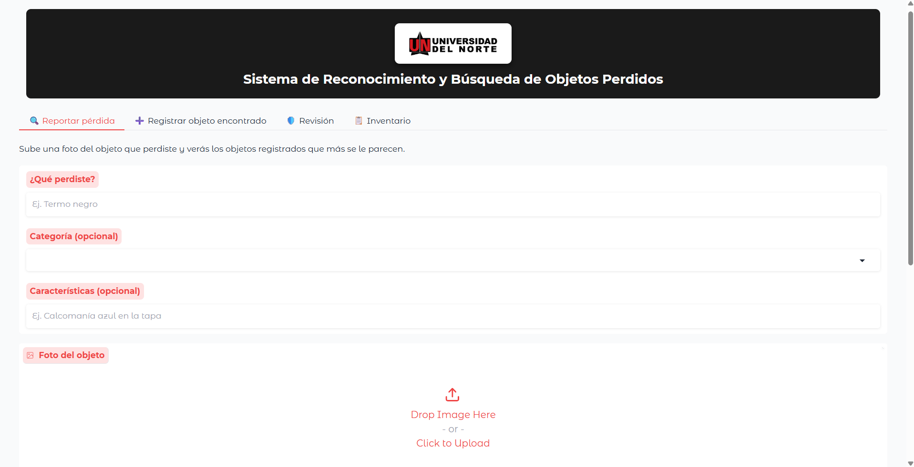

# Sistema de reconocimiento y búsqueda de objetos perdidos

**Autores:** Isabella M. Peña, Sofía A. Rodríguez, José D. Bolaños, Gerbin Moreno y Sebastián J. Berrio
**Curso:** 3231 Matématicas Discretas · Universidad del Norte · Noviembre de 2026



## 1. Descripción general

Este proyecto desarrolla un sistema web para facilitar la identificación
de objetos perdidos. Una persona puede registrar un objeto encontrado o
reportar la pérdida de uno. El sistema compara las fotografías y genera
posibles coincidencias para ayudar a relacionar ambos reportes.

El proyecto utiliza técnicas de visión por computador y conceptos de
Matemáticas Discretas:

-   **DINOv2:** transforma las imágenes en representaciones numéricas
    llamadas *embeddings*.
-   **Similitud coseno:** calcula qué tan parecidas son dos
    representaciones.
-   **Grafo bipartito:** relaciona los reportes de objetos perdidos con
    los objetos encontrados.
-   **Algoritmo húngaro variante Jonker-Volgenant:** busca un emparejamiento de peso máximo entre
    los elementos disponibles.
-   **Categorías:** permiten organizar los objetos según sus
    características.

La aplicación cuenta con una interfaz web desarrollada con Gradio y
utiliza SQLite para almacenar la información.

## 2. Requisitos

Antes de instalar el proyecto, verifica que tengas:

-   Windows.
-   Python de 64 bits. Se recomienda **Python 3.12.10**, versión con la
    que se comprobó la instalación. Las versiones más recientes, como las de la serie 3.14 o 3.15, pueden no ser compatibles con algunas dependencias y no permitir ejecutar el código.
-   PowerShell.
-   Conexión a internet durante la primera ejecución, para descargar el
    modelo DINOv2 y sus archivos necesarios.

El proyecto indica compatibilidad con Python 3.10 o superior, pero la
instalación comprobada se realizó con Python 3.12.10. Otras versiones
pueden requerir ajustes en las dependencias.

## 3. Estructura del proyecto

La carpeta principal contiene los siguientes archivos y directorios:

``` text
proyecto/
├── app.py
├── motor.py
├── almacen.py
├── importar_carpetas.py
├── requirements.txt
├── .gitignore
├── README.md
├── logo-uninorte.png
├── captura.png
└── imagenes/
    ├── catalogo/
    └── reportes/
```

Descripción de los principales elementos:

-   `app.py`: contiene la aplicación web y sus pestañas.
-   `motor.py`: realiza el procesamiento de imágenes, genera embeddings,
    calcula similitudes y ejecuta el proceso de emparejamiento.
-   `almacen.py`: administra la base de datos SQLite y la información
    almacenada.
-   `importar_carpetas.py`: permite importar las imágenes de prueba
    organizadas en carpetas.
-   `requirements.txt`: contiene las dependencias de Python necesarias.
-   `imagenes/catalogo/`: contiene las imágenes de los objetos
    encontrados, organizadas en subcarpetas.
-   `imagenes/reportes/`: contiene las fotografías asociadas a los
    reportes de pérdida.
-   `datos/`: almacena los datos que utiliza la aplicación. Se crea o
    utiliza durante la ejecución, según la configuración.

## 4. Instalación

### Paso 1. Instalar Python

Instala Python 3.12.10 de 64 bits. Durante la instalación, activa la
opción **Add Python to PATH** si aparece.

Para comprobar la instalación, abre PowerShell y ejecuta:

``` powershell
py -3.12 --version
```

Deberías obtener una respuesta similar a:

``` text
Python 3.12.10
```

### Paso 2. Abrir PowerShell en la carpeta del proyecto

Abre la carpeta del proyecto en el Explorador de archivos. En la barra
de dirección escribe `powershell` y presiona Enter.

También puedes abrir una terminal desde Visual Studio Code, asegurándote
de que la ruta corresponda a la carpeta principal del proyecto.

### Paso 3. Crear el entorno virtual

Ejecuta:

``` powershell
py -3.12 -m venv .venv
```

Esto crea un entorno virtual llamado `.venv`, que permite instalar las
dependencias del proyecto sin mezclarlas con las de otras instalaciones
de Python.

### Paso 4. Activar el entorno virtual

En PowerShell, ejecuta:

``` powershell
Set-ExecutionPolicy -Scope Process Bypass
```

Si PowerShell solicita confirmación, acepta el cambio para la sesión
actual. Después ejecuta:

``` powershell
.\.venv\Scripts\Activate.ps1
```

Cuando el entorno esté activo, normalmente aparecerá `(.venv)` al inicio
de la línea de comandos.

> El cambio de política se aplica únicamente al proceso actual de
> PowerShell; no modifica permanentemente la configuración del sistema.

### Paso 5. Actualizar las herramientas de instalación

Ejecuta estos comandos:

``` powershell
python -m pip install --upgrade pip
python -m pip install --upgrade setuptools wheel
```

### Paso 6. Instalar las dependencias

Primero instala PyYAML mediante un paquete binario:

``` powershell
python -m pip install --only-binary=:all: PyYAML
```

Después instala las demás dependencias del proyecto:

``` powershell
pip install -r requirements.txt
```

Si la instalación termina correctamente, el entorno estará preparado
para ejecutar la aplicación.

## 5. Ejecutar el proyecto

### Paso 1. Importar las imágenes de prueba

Si deseas cargar el conjunto de datos de prueba incluido con el
proyecto, ejecuta:

``` powershell
python importar_carpetas.py
```

Esta importación se realiza para preparar los objetos y reportes de
prueba. No es necesario repetirla cada vez que abras la aplicación.

### Paso 2. Iniciar la aplicación

Ejecuta:

``` powershell
python app.py
```

Cuando la aplicación termine de iniciar, abre en el navegador la
dirección:

``` text
http://127.0.0.1:7860
```

Para que la aplicación siga funcionando, mantén abierta la terminal
donde ejecutaste el comando. Para detenerla, presiona `Ctrl + C`.

## 6. Funcionalidades de la aplicación

La interfaz contiene cuatro pestañas principales:

### 6.1. Reportar pérdida

Permite registrar la pérdida de un objeto mediante una fotografía y la
información solicitada por el formulario.

El sistema compara la imagen con los objetos encontrados y muestra los
cinco candidatos más parecidos. La persona puede guardar el reporte y
sus datos de contacto, o realizar únicamente una búsqueda, según las
opciones disponibles en la interfaz.

### 6.2. Registrar objeto encontrado

Permite registrar un objeto encontrado con una o varias fotos del mismo objeto y la información correspondiente, como el nombre, la categoría y el lugar donde fueron encontrados. Para registrar otro objeto, repite el formulario.

### 6.3. Revisión

Permite revisar las posibles coincidencias propuestas por el sistema. El
revisor elige un reporte pendiente, compara sus fotos con las del objeto sugerido (o con otros candidatos) y puede confirmar o rechazar una coincidencia. Un par rechazado no vuelve a proponerse. Esta etapa es
importante porque una similitud alta no garantiza que dos fotografías
correspondan al mismo objeto.

La pestaña solicita una contraseña. La clave predeterminada es:

``` text
cambiar-esta-clave
```

Se recomienda cambiarla antes de utilizar el sistema con información
real.

### 6.4. Inventario

Muestra los objetos registrados y permite consultar la galería y filtrar
los resultados por categoría.

## 7. Configuración

### 7.1. Cambiar la contraseña de revisión

Antes de iniciar la aplicación, puedes definir una contraseña diferente
desde PowerShell:

``` powershell
$env:CLAVE_REVISOR = "tu-clave"
python app.py
```

Sustituye `tu-clave` por la contraseña que quieras utilizar.

Esta variable de entorno se establece para la sesión actual de
PowerShell. Si abres otra terminal, tendrás que definirla nuevamente.

### 7.2. Cambiar la ubicación de los datos

Por defecto, la aplicación utiliza la carpeta `datos`. Si deseas
utilizar otra ubicación, define la variable `DATOS_DIR` antes de
ejecutar los scripts que trabajan con esos datos.

Ejemplo:

``` powershell
$env:DATOS_DIR = "C:\ruta\a\otra\carpeta"
python importar_carpetas.py
python app.py
```

Utiliza la misma ubicación al importar los datos y al iniciar la
aplicación para que ambos procesos trabajen con la misma base de datos.

## 8. Fundamentos matemáticos y computacionales

### 8.1. Representación de imágenes mediante embeddings

DINOv2 procesa cada fotografía y genera un vector numérico que
representa características visuales de la imagen. De esta manera, las
fotografías pueden compararse matemáticamente.

### 8.2. Similitud coseno

La similitud coseno permite comparar dos embeddings y estimar qué tan
parecidos son según la orientación de sus vectores.

Para dos vectores (A) y (B), se calcula mediante:

$$
\operatorname{sim}(A,B) = \frac{A \cdot B}{\|A\|\,\|B\|}
$$

El resultado se utiliza como peso para representar la semejanza entre un
reporte de pérdida y un objeto encontrado.

### 8.3. Grafo bipartito

El problema se representa mediante un grafo bipartito. Un conjunto de
vértices representa los reportes de objetos perdidos y el otro conjunto
representa los objetos encontrados.

Las aristas conectan elementos de conjuntos diferentes. El peso de cada
arista corresponde a la similitud calculada entre las imágenes.

### 8.4. Algoritmo húngaro (Variante)

El algoritmo húngaro se utiliza para encontrar una asignación de peso
máximo entre los reportes de pérdida y los objetos encontrados. Esto
permite seleccionar un conjunto de emparejamientos que optimiza la
similitud total, de modo que cada reporte recibe a lo sumo un objeto y cada objeto a lo sumo un reporte. Los pares que el algoritmo asigna sin que exista arista (similitud bajo el umbral o par rechazado) se descartan.

### 8.5. Categorías y clases de equivalencia

Las categorías permiten agrupar objetos que comparten una característica
general, como su tipo. Desde el punto de vista matemático, una
clasificación puede relacionarse con clases de equivalencia cuando se
define una relación de equivalencia sobre los elementos.

## 9. Diagnóstico

El proyecto incluye una opción para ejecutar un diagnóstico del motor:

``` powershell
python motor.py --diagnostico
```
El diagnóstico lee las carpetas, imprime la matriz de similitudes, el emparejamiento óptimo y los candidatos de cada reporte. Este comando permite comprobar aspectos del funcionamiento del módulo de
procesamiento.

## 10. Limitaciones conocidas

-   El umbral de similitud de `0.45` se calibró con un conjunto de
    prueba pequeño de 30 objetos. Por tanto, no debe considerarse un
    valor definitivo para cualquier conjunto de datos.
-   Objetos visualmente parecidos pueden producir puntuaciones elevadas.
    Por ejemplo, dos termos negros podrían obtener una similitud alta
    aunque no sean el mismo objeto.
-   Las coincidencias son sugerencias: la revisión humana sigue siendo
    necesaria antes de confirmar que un objeto corresponde a un reporte.
-   El sistema no detecta automáticamente todos los registros
    duplicados.
-   No se realizan notificaciones automáticas a las personas. El proceso
    de contacto depende del revisor y de la información registrada.
-   La revisión utiliza una contraseña compartida y no cuenta con un
    límite de intentos configurado.
-   El formato HEIC no está soportado actualmente; se recomienda
    utilizar formatos de imagen compatibles, como JPG, JPEG, PNG, BMP y WEBP.

## 11. Seguridad y uso con información real

La contraseña predeterminada de revisión debe cambiarse antes de
utilizar el sistema con información real.

Si el proyecto se publica para que otras personas accedan desde
internet, será necesario revisar su configuración de seguridad y
desplegarlo en un entorno adecuado. Como mínimo, se debe considerar:

-   Utilizar HTTPS.
-   Proteger el acceso a las funciones de revisión.
-   Mantener copias de seguridad de la base de datos y las fotografías.
-   Utilizar almacenamiento persistente para evitar perder los datos al
    reiniciar el servicio.
-   Informar a los usuarios sobre el tratamiento de sus fotografías y
    datos de contacto.
-   Aplicar las medidas necesarias para proteger los datos personales.

La ejecución local en `127.0.0.1` está pensada para pruebas en el equipo
donde se ejecuta la aplicación; no equivale a un despliegue público
seguro.

## 12. Reiniciar los datos de prueba

Si necesitas comenzar nuevamente con los datos de prueba:

1.  Detén la aplicación presionando `Ctrl + C` en PowerShell.
2.  Elimina la carpeta `datos`.
3.  Ejecuta de nuevo el importador:

``` powershell
python importar_carpetas.py
```

4.  Inicia la aplicación:

``` powershell
python app.py
```

> **Advertencia:** eliminar la carpeta de datos puede borrar reportes,
> contactos, registros y otra información almacenada. Haz una copia de
> seguridad antes de realizar este procedimiento si necesitas
> conservarla.

## 13. Uso en sesiones posteriores

Una vez instalado el proyecto, no es necesario repetir todos los pasos
de instalación cada vez que quieras utilizarlo.

En una nueva sesión:

1.  Abre PowerShell en la carpeta del proyecto.
2.  Activa el entorno virtual:

``` powershell
.\.venv\Scripts\Activate.ps1
```

3.  Si cambiaste la contraseña o la ubicación de los datos, define
    nuevamente las variables de entorno correspondientes.
4.  Inicia la aplicación:

``` powershell
python app.py
```

5.  Abre `http://127.0.0.1:7860` en el navegador.

------------------------------------------------------------------------

## Autoría y propósito académico

Este proyecto fue desarrollado como una aplicación de los conceptos de
Matemáticas Discretas al problema de reconocimiento y búsqueda de
objetos perdidos. Integra herramientas de inteligencia artificial,
representación mediante grafos y técnicas de optimización para apoyar la
identificación de posibles coincidencias.
